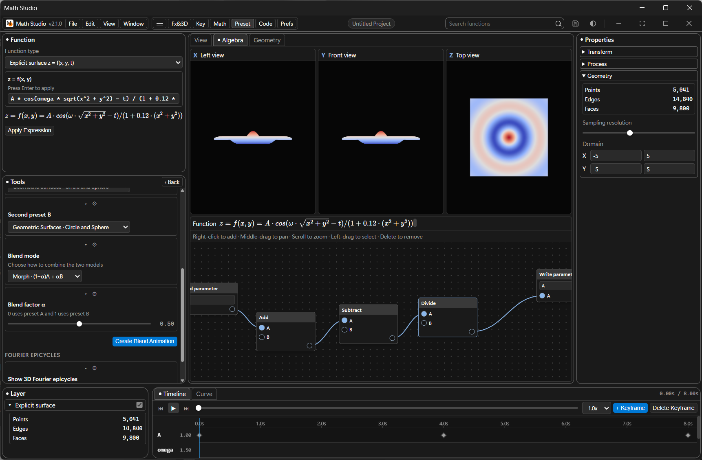

# Math Studio — Windows 11 Fluent Edition

[简体中文](./README.md) | **English**

> Math functions · 3D visualization · keyframe animation · symbolic calculus · node editor — a Windows desktop workbench that turns a mathematical expression into an interactive 3D world.

**v2.1.0** is a full UI and interaction overhaul: a top menu bar, dockable workspaces, a math node editor, a mesh workspace, orthographic left/front/top views, a bilingual interface and rich modal dialogs — with the layout and information hierarchy rebuilt from the ground up.



---

## ✨ What's New in v2.1.0

- **New top menu bar**: `File / Edit / View / Windows` plus a brand menu (About / Help / Report / Version) — every feature is now one click away instead of buried in side panels.
- **Math node editor** (`math_nodes.js`): a visual expression graph — add / subtract / multiply / divide / power / modulo, sine / cosine / tangent / square root / exponential / natural log, with `Write parameter` driving any animation parameter; right-click to add nodes, middle-drag to pan, scroll to zoom, box-select and Delete to remove.
- **Mesh workspace** (`mesh_workspace.js`): capture the current surface as an editable mesh with vertex / edge / face selection, position nudging, Gaussian curvature K readout, selection by attribute (height / curvature / mean …) with highlight marking, and live base color / roughness controls.
- **Orthographic three-view** (`orthographic_views.js`): X left view, Y front view and Z top view side by side with the main 3D viewport, updating in sync.
- **Property shading** (`property_shading.js`): map height / gaussian / mean / solid surface properties onto the Cool-Warm, Viridis, Plasma, Rainbow, Neon and Gray palettes.
- **Viewport guides** (`viewport_guides.js`): floor grid, orthographic grid, axes, cursor position, wireframe mode and opacity are independently toggleable.
- **Bilingual interface** (`i18n.js` + `messages.js`): one-click switch between Simplified Chinese and English; the language preference is persisted to `~/.math_studio_preferences.json`.
- **Three themes**: Dark, Light and Pure Black (cyber focus), consistent with the Windows 11 Fluent design language.
- **Rich modal dialogs**: About, Help (shortcuts / syntax / keyframes / calculus tabs), Report, Version and an Import wizard.

---

## 🧩 Core Capabilities

### Expressions & Geometry
- Explicit surface `z = f(x, y, t)`
- Space parametric curve `(x(u), y(u), z(u))` with Frenet-Serret frame
- 3D parametric surface `(x(u,v), y(u,v), z(u,v))`
- 3D vector field `F(x,y,z) = (u, v, w)` with animated arrow arrays
- Live expression validation and synchronized LaTeX rendering (KaTeX)

### Animation & Keyframes
- Keyframe any custom parameter (`A, ω, φ, R, k, α` …)
- Nested composite-function interpolation between adjacent keyframes: `V(t) = V₁ + (V₂ − V₁)·g(f(τ))` with built-in smooth / damped-oscillation / bounce / sigmoid presets
- Timeline / Curve tabs: keyframe editing and interpolation-curve editing
- Looping playback, global duration control, preset composite transition functions

### Symbolic Calculus (SymPy)
- First / second derivatives, partial derivatives ∂z/∂x, ∂z/∂y, Hessian matrix
- Gradient field ∇f visualization and a 3D tangent plane at any point
- Multivariate Taylor polynomial expansion, definite / indefinite integrals, 3D Riemann-sum columns

### Presets & Multi-wave Blending
- Circle / sphere / torus / water waves / Fourier square and sawtooth waves / Lissajous / Möbius strip / saddle
- Preset blender: morphing transitions, interference superposition, product modulation, Gaussian-envelope convolution
- 3D Fourier rotating phasor chain (Epicycles)

### Code Generation & Video Export
- Generate a standalone, runnable **HTML5 + Three.js** single file or a **Python (Matplotlib)** 3D animation script in one click
- Frame-by-frame offscreen rendering piped straight into FFmpeg: 720P / 1080P / 2K, 30 / 60 fps, H.264 `.mp4` (CRF 18)
- PNG capture, WebM recording and recording cancellation

### Workspace & Projects
- Resource Hub: new / open / recent projects persisted as `*.mathstudio.json`
- Draggable layout with persisted sizes for Function / Program / Attribute / Layer / Timeline panels
- Menu shortcuts, window fullscreen / maximize / minimize / reset size

---

## 📁 Project Structure

```
Math Studio/
├── app.py                      # Entry point: PyWebView + Edge WebView2 + native API
├── calculus_engine.py          # SymPy symbolic calculus engine
├── video_exporter.py           # FFmpeg frame-by-frame video pipeline
├── build_frontend.js           # esbuild bundler (src → web_dist)
├── build_exe.py                # PyInstaller packaging script (Math Studio.exe)
├── generate_icon.py            # Application icon generator
├── docs/
│   └── screenshot.png          # UI screenshot
├── src/
│   ├── index.html              # Single-page UI: Resource Hub + Studio + rich modals
│   ├── main.js                 # App orchestrator (menus / panels / modals / import-export)
│   ├── modules/
│   │   ├── code_generator.js   # HTML / Python source generation
│   │   ├── expression_parser.js# Expression parsing & validation
│   │   ├── i18n.js             # Bilingual localization runtime
│   │   ├── keyframe_engine.js  # Keyframe interpolation & composite engine
│   │   ├── math_nodes.js       # Math node editor
│   │   ├── mesh_workspace.js   # Mesh capture / selection / attribute shading
│   │   ├── messages.js         # Chinese & English message tables
│   │   ├── orthographic_views.js # Left / front / top orthographic views
│   │   ├── panel_manager.js    # Dockable panel management
│   │   ├── presets_manager.js  # Preset library & blend synthesizer
│   │   ├── property_shading.js # Surface property shading & palettes
│   │   ├── timeline_editor.js  # Timeline & curve editor
│   │   ├── viewport3d.js       # Three.js 3D viewport
│   │   └── viewport_guides.js  # Grid / axes / cursor guides
│   └── styles/
│       ├── win11_settings.css  # Windows 11 Fluent theme
│       └── math_nodes.css      # Node editor styles
├── app_icon.ico / app_icon.png # Application icons
├── package.json / package-lock.json
├── LICENSE
├── 使用说明.md                  # Chinese usage guide
└── README.md
```

---

## 🚀 Quick Start

### Requirements

- **Python 3.13+** (`pywebview`, `sympy`, `mpmath`, `Pillow`)
- **Node.js 18+** (`esbuild`, `three`, `mathjs`, `katex`)
- **FFmpeg** (video export)

### Install Dependencies

```bash
pip install pywebview sympy mpmath pillow
npm install
```

### Build & Run

```bash
# 1. Bundle the frontend (generates web_dist/)
node build_frontend.js

# 2. Launch the app (Edge WebView2)
python app.py
```

> `app.py` tries `web_dist/`, `dist/` and `src/` in that order, so you must run `node build_frontend.js` first — otherwise `bundle.js` and the KaTeX fonts are missing.

### Package as a Standalone EXE

```bash
python build_exe.py
```

Produces `Math Studio.exe` (requires PyInstaller and WebView2 dependencies such as pythonnet / clr_loader).

---

## 📦 Version History

| Version | Notes |
|---------|-------|
| **v2.1.0** | Top menu bar, math node editor, mesh workspace, orthographic three-view, property shading, viewport guides, bilingual UI, three themes, rich modals; full UI and layout overhaul |
| v1.2.0 | Removed the splash screen, added the panel manager, synced the Back up3 sources |
| v1.1.0 | Splash loading animation, timeline editor and various improvements |
| v1.0.0 | First release: PyWebView + SymPy + Three.js + FFmpeg pipeline |

---

## 🔧 Tech Stack

| Layer | Technology |
|-------|------------|
| Desktop container | PyWebView (Edge Chromium / WebView2) |
| Frontend | Vanilla JS + Three.js + Math.js + KaTeX + esbuild |
| Symbolic math | SymPy |
| Video encoding | FFmpeg (H.264 / CRF 18 / yuv420p) |
| Packaging | PyInstaller (onefile / windowed) |

---

## 📄 License

[MIT](./LICENSE) © 2026 SOKUZA
