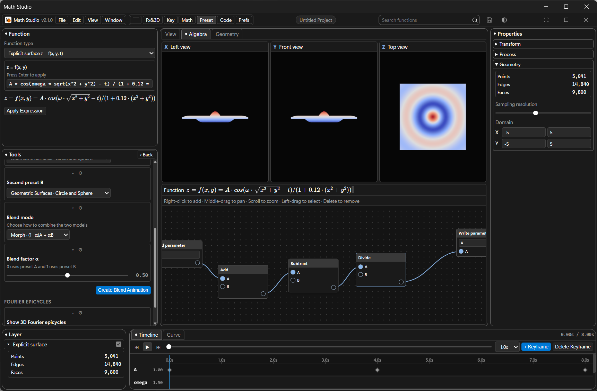

# Math Studio — Windows 11 Fluent Edition

**简体中文** | [English](./README.en.md)

> 数学函数 · 3D 可视化 · 关键帧动画 · 符号微积分 · 节点编辑器 —— 一个把「数学表达式」变成「可交互 3D 世界」的 Windows 桌面工作台。

**v2.1.0** 是一次全面的界面与交互改版：顶部菜单栏、可停靠工作区、数学节点编辑器、网格工作区、左/正/顶正交视图、双语界面与富模态框一并上线，排版与信息层级整体重做。



---

## ✨ v2.1.0 亮点

- **全新顶部菜单栏**：`File / Edit / View / Windows` 四组菜单 + 品牌菜单（关于 / 帮助 / 报告 / 版本信息），所有功能不再深埋于侧栏。
- **数学节点编辑器**（`math_nodes.js`）：可视化的表达式图 —— 加法 / 减法 / 乘法 / 除法 / 乘方 / 取余，正弦 / 余弦 / 正切 / 平方根 / 指数 / 自然对数，`Write parameter` 输出到任意动画参数；右键添加节点、中键平移、滚轮缩放、框选与 Delete 删除。
- **网格工作区**（`mesh_workspace.js`）：捕获当前曲面为可编辑网格，支持顶点 / 边 / 面选择、位置微调、高斯曲率 K 查询、按属性（高度 / 曲率 / 均值等）筛选并高亮标记，底色与粗糙度实时调节。
- **三视图正交投影**（`orthographic_views.js`）：视口右侧并排展示 X 左视图、Y 正视图、Z 顶视图，与主 3D 视口同步刷新。
- **属性着色**（`property_shading.js`）：height / gaussian / mean / solid 等曲面属性映射到 Cool-Warm、Viridis、Plasma、Rainbow、Neon、Gray 调色板。
- **视口参考系**（`viewport_guides.js`）：地面网格、正交网格、坐标轴、光标位置、线框模式与透明度均可独立开关。
- **双语界面**（`i18n.js` + `messages.js`）：简体中文 / English 一键切换，语言偏好持久化到 `~/.math_studio_preferences.json`。
- **三套主题**：深色（Dark）、浅色（Light）、纯黑赛博专注（Pure Black），与 Windows 11 Fluent 设计语言保持一致。
- **富模态框**：关于、帮助（快捷键 / 函数语法 / 关键帧 / 微积分四页签）、问题反馈、版本信息、导入向导。

---

## 🧩 核心能力

### 数学表达式与几何体
- 显式曲面 `z = f(x, y, t)`
- 空间参数曲线 `(x(u), y(u), z(u))` + Frenet-Serret 标架
- 三维参数曲面 `(x(u,v), y(u,v), z(u,v))`
- 三维向量场 `F(x,y,z) = (u, v, w)`，箭头阵列动态呈现
- 表达式实时校验、LaTeX 公式同步渲染（KaTeX）

### 动画与关键帧
- 任意自定义参数（`A, ω, φ, R, k, α` …）打关键帧
- 相邻关键帧间复合函数嵌套 `V(t) = V₁ + (V₂ − V₁)·g(f(τ))`，内置平滑 / 阻尼谐振 / 弹跳 / Sigmoid 过渡预设
- Timeline / Curve 双页签：关键帧编辑与插值曲线编辑
- 循环往复播放、全局时长控制、预设复合过渡函数

### 符号微积分（SymPy）
- 一阶 / 二阶导数、偏导数 ∂z/∂x、∂z/∂y、Hessian 矩阵
- 梯度矢量场 ∇f 可视化、任意切点三维切平面
- 多元泰勒多项式展开、定积分 / 不定积分、三维黎曼和柱体

### 预设库与多波混合
- 圆 / 球面 / 环面 / 水波 / 傅里叶方波与锯齿波 / 李萨如 / 莫比乌斯带 / 马鞍面
- 预设混合器：形变过渡（Morph）、干涉叠加、乘积调幅、高斯包络卷积
- 3D 傅里叶旋转相量链（Epicycles）

### 代码生成与视频导出
- 一键生成独立可运行的 **HTML5 + Three.js** 单文件，或 **Python (Matplotlib)** 3D 动画脚本
- 逐帧离屏渲染直连 FFmpeg，输出 720P / 1080P / 2K、30 / 60fps 的 H.264 `.mp4`（CRF 18）
- 支持 PNG 截图、WebM 录制与取消录制

### 工作区与项目
- 项目资源窗口（Resource Hub）：新建 / 打开 / 最近项目，项目以 `*.mathstudio.json` 持久化
- 可拖拽布局：Function / Program / Attribute / Layer / Timeline 各面板尺寸持久化
- 菜单栏快捷键、窗口全屏 / 最大化 / 最小化 / 重置尺寸

---

## 📁 项目结构

```
Math Studio/
├── app.py                      # 主入口：PyWebView + Edge WebView2 + 原生 API
├── calculus_engine.py          # SymPy 符号计算引擎
├── video_exporter.py           # FFmpeg 逐帧编码视频管线
├── build_frontend.js           # esbuild 打包脚本（src → web_dist）
├── build_exe.py                # PyInstaller 打包脚本（生成 Math Studio.exe）
├── generate_icon.py            # 应用图标生成
├── docs/
│   └── screenshot.png          # 界面截图
├── src/
│   ├── index.html              # 单页 UI：资源中心 + 工作台 + 富模态框
│   ├── main.js                 # 应用编排器（菜单 / 面板 / 模态框 / 导入导出）
│   ├── modules/
│   │   ├── code_generator.js   # HTML / Python 源码生成
│   │   ├── expression_parser.js# 表达式解析与校验
│   │   ├── i18n.js             # 双语本地化运行时
│   │   ├── keyframe_engine.js  # 关键帧插值与复合函数引擎
│   │   ├── math_nodes.js       # 数学节点编辑器
│   │   ├── mesh_workspace.js   # 网格捕获 / 选择 / 属性着色
│   │   ├── messages.js         # 中英文文案表
│   │   ├── orthographic_views.js # 左 / 正 / 顶三视图
│   │   ├── panel_manager.js    # 可拖拽面板管理
│   │   ├── presets_manager.js  # 预设库与混合合成器
│   │   ├── property_shading.js # 曲面属性着色与调色板
│   │   ├── timeline_editor.js  # 时间轴与曲线编辑器
│   │   ├── viewport3d.js       # Three.js 3D 视口
│   │   └── viewport_guides.js  # 网格 / 坐标轴 / 光标参考系
│   └── styles/
│       ├── win11_settings.css  # Windows 11 Fluent 主题
│       └── math_nodes.css      # 节点编辑器样式
├── app_icon.ico / app_icon.png # 应用图标
├── package.json / package-lock.json
├── LICENSE
├── 使用说明.md                  # 中文使用说明
└── README.md
```

---

## 🚀 快速开始

### 环境要求

- **Python 3.13+**（`pywebview`、`sympy`、`mpmath`、`Pillow`）
- **Node.js 18+**（`esbuild`、`three`、`mathjs`、`katex`）
- **FFmpeg**（视频导出）

### 安装依赖

```bash
pip install pywebview sympy mpmath pillow
npm install
```

### 构建并运行

```bash
# 1. 打包前端（生成 web_dist/）
node build_frontend.js

# 2. 启动应用（Edge WebView2）
python app.py
```

> `app.py` 会依次尝试 `web_dist/`、`dist/`、`src/`，首次运行前必须先执行 `node build_frontend.js`，否则 `bundle.js` 与 KaTeX 字体缺失。

### 打包为独立 exe

```bash
python build_exe.py
```

生成 `Math Studio.exe`（需 PyInstaller 及 pythonnet / clr_loader 等 WebView2 依赖）。

---

## 📦 版本历史

| 版本 | 说明 |
|------|------|
| **v2.1.0** | 顶部菜单栏、数学节点编辑器、网格工作区、正交三视图、属性着色、视口参考系、双语界面、三主题、富模态框；界面与排版全面重做 |
| v1.2.0 | 移除启动加载页、新增面板管理器，同步 Back up3 源码 |
| v1.1.0 | 启动加载动画、时间轴编辑器与多项优化 |
| v1.0.0 | 首个正式版本：PyWebView + SymPy + Three.js + FFmpeg 管线 |

---

## 🔧 技术栈

| 层 | 技术 |
|----|------|
| 桌面容器 | PyWebView（Edge Chromium / WebView2） |
| 前端 | 原生 JS + Three.js + Math.js + KaTeX + esbuild |
| 符号计算 | SymPy |
| 视频编码 | FFmpeg（H.264 / CRF 18 / yuv420p） |
| 打包 | PyInstaller（onefile / windowed） |

---

## 📄 License

[MIT](./LICENSE) © 2026 SOKUZA
